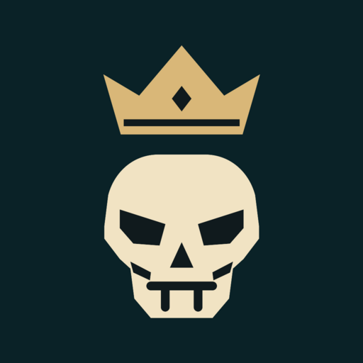
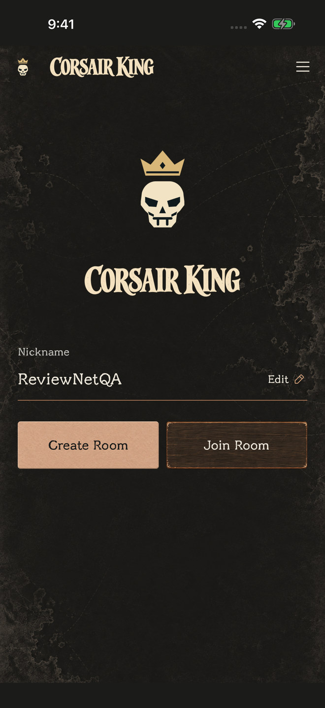
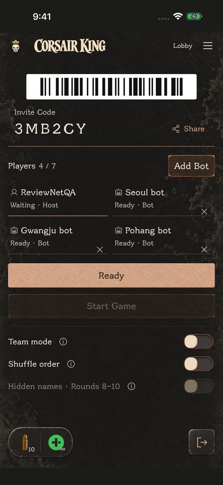
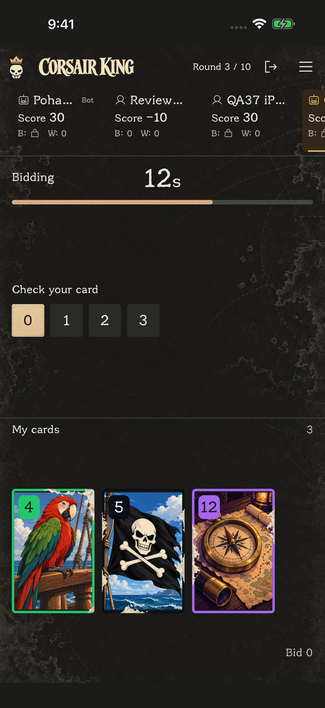
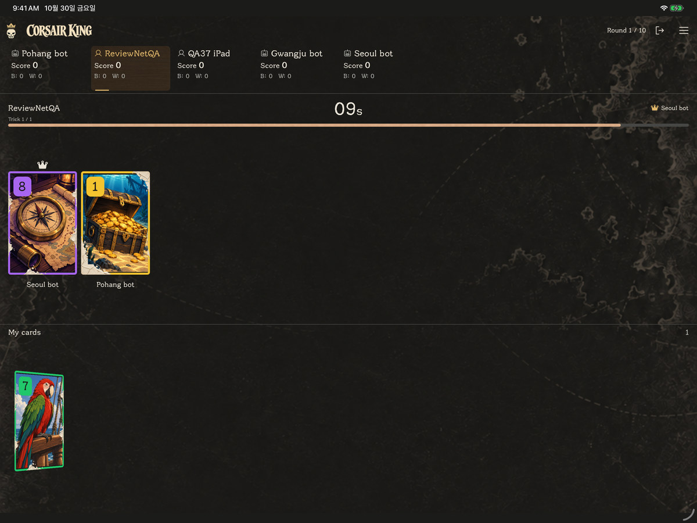
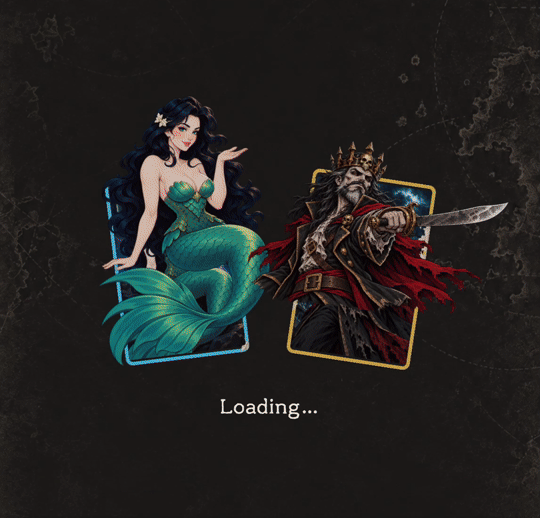
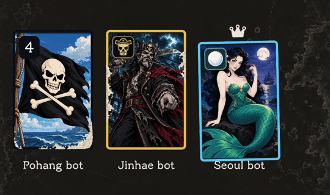
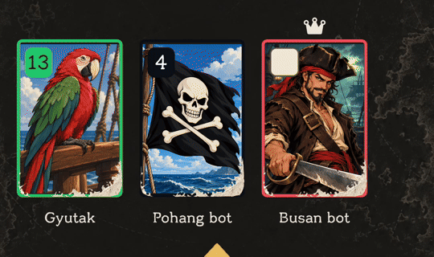
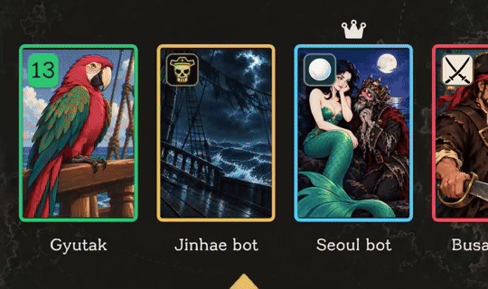

  

<h1 align="center">Corsair King</h1>

친구와 함께, 이번엔 몇 번 이길까? Predict your wins. Play your cards.

  <a href="https://apps.apple.com/kr/app/corsair-king/id6826480808">App Store</a> ·
  <a href="https://github.com/HahnGyuTak/CorsairKing-downloads/releases/latest">Android 다운로드</a> ·
  <a href="https://github.com/HahnGyuTak/CorsairKing-downloads">설치 안내 · 테스트 배포</a>

손패를 보고 이번 라운드에 몇 번 이길지 예측하세요. 강한 카드를 내는 것만큼, 자신이 정한 승수를 정확히 맞추는 것이 중요합니다. 해적과 바다의 캐릭터들이 판세를 바꾸는 **2–7인 온라인 카드게임**입니다.

## 실제 게임 화면

<table>
  <tr>
    <td align="center"> <b>친구와 같은 방으로</b></td>
    <td align="center"> <b>준비하고 함께 시작</b></td>
    <td align="center"> <b>예측하고, 차례에 맞춰 한 장</b></td>
  </tr>
</table>

초대 코드나 바코드로 같은 방에 모입니다. 빈자리는 Bot으로 채울 수 있어 혼자 접속해도 시작할 수 있습니다. 10라운드 동안 받는 카드가 한 장씩 늘어나며, 개인전과 팀전을 선택해 즐길 수 있습니다. 팀전은 팀원 개인 점수의 평균으로 승부합니다.

**큰 화면에서도 함께** — iPad는 가로·세로 화면을 지원합니다. 넓은 화면에서 플레이어 정보와 필드, 손패를 함께 확인하세요.

## 카드 속 작은 이야기

아래 GIF는 실제 앱의 게임 내 연출을 캡처했습니다.

**게임 시작 소극장** — 해적·세이렌·데비 존스의 관계를 짧은 장면으로 보여 줍니다. 카드 속 캐릭터들이 작은 무대의 주인공이 됩니다.

**세이렌과 데비 존스** — 세이렌이 데비 존스를 홀리면 두 캐릭터가 한 카드에 함께 등장합니다. 특수카드의 만남이 카드 속 삽화까지 바꿉니다.

**모비딕의 등장** — 필드의 카드들이 차례로 뒤집힙니다. 숫자카드는 고래 꼬리로, 다른 특수카드는 낡은 백지로 변하고 모비딕은 자신의 모습을 유지합니다.

**하프구바의 습격** — 거대한 촉수가 카드 속 캐릭터들을 붙잡습니다. 카드의 숫자와 테두리는 그대로 두고 삽화가 바뀌는 연출입니다.

## 함께 즐기는 방법

- **개인전 · Team mode**: 혼자 점수를 겨루거나 해적·세이렌·데비 존스 팀에 합류하세요.
- **방장 게임 옵션**: 라운드마다 순서를 섞고, 후반 라운드에서 닉네임을 잠시 가릴 수 있습니다.
- **가볍게 입장**: 이메일·비밀번호 없이 닉네임으로 시작합니다. 바코드 카메라는 선택 사항입니다.
- **iPhone · iPad · Android**: 게임 규칙은 한국어와 영어로 확인할 수 있습니다.

인터넷 연결이 필요합니다. iOS는 [App Store](https://apps.apple.com/kr/app/corsair-king/id6826480808)에서, Android APK와 테스트 설치 안내는 [GitHub 배포 페이지](https://github.com/HahnGyuTak/CorsairKing-downloads)에서 확인하세요.

[지원](https://corsair-king.pages.dev/support/) · [개인정보처리방침](https://corsair-king.pages.dev/privacy/) · [계정 삭제 안내](https://corsair-king.pages.dev/delete/)
